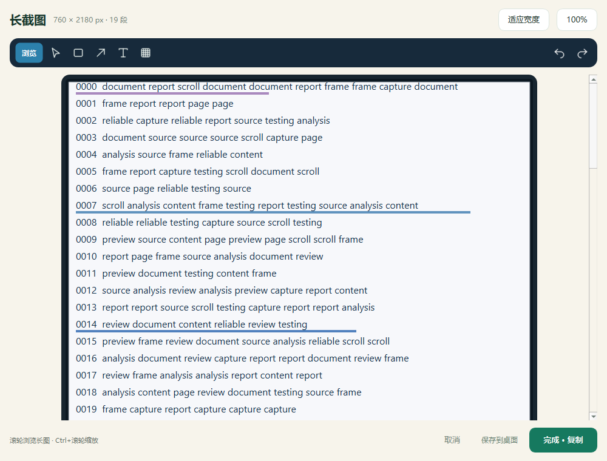

# 长截图快速滚动修复

2026-10-20，更新本地源码；安装包与 GitHub 尚未同步本轮修改。

## 处理结果

连续滚动时更频繁地采集画面，强化正文重叠校验，并保留框选首屏与结束前的最后一帧。真实 Windows 快速滚轮测试中，旧版在中途丢失重叠，新版获得了完整高度，100% 和 150% Qt 缩放的正式入口流程均通过。

## 原因与修改

- 原采集周期为 200ms，匹配也在同一个界面线程执行。滚动较快时，两次采集之间容易跳过可用的中间画面。改用 50ms 精确定时器，并减少特征构建和弱候选校验的成本；这是目标间隔，实际频率仍受电脑负载影响。
- 旧算法要求至少 20% 的画面重叠；在 900px 高的测试画面中，即使还剩 160px 或 100px 的真实重叠也无法连接。扩大允许搜索的范围，同时校验正文前景像素，避免大片留白掩盖文本差异。
- 新校验使用整行与多个横向区域的独立特征，降低重复锚点的权重。只容忍局部的小范围动画，继续拒绝不相关页面、模糊的重复图案和无法验证的重叠。
- 从框选层交接时保留原始首屏；启动延迟由 220ms 降为 80ms，避免交接期间的滚动让首屏消失。
- 点击完成时直接对最后一帧做相同的可靠重叠校验，不再要求用户先停止滚动或等待两帧静止。
- 无法连接时保留现有长图并提示向上返回；未确认的画面不替换已采集的末帧，回到可匹配位置后可以继续。

涉及 `document_assistant/long_stitch.py`、`long_capture.py` 和 `screen_capture.py`，新增 `tests/test_long_capture.py`。没有改动用户文档、文档库或数据库架构。

## 验证证据

所有输入均为本地生成的临时示例，没有自动滚动或整理真实资料。真实滚轮由 Windows 输入接口发送到测试窗口，结束后恢复鼠标位置。

| 场景 | 结果 |
| --- | --- |
| 900px 画面，每次滚动 100、740、800px | 追加距离正确，整个合成长图与参考页面逐像素一致 |
| 完全跳过重叠后返回、无关页面、重复条纹、向上滚动、局部动画 | 不误加内容，返回到接缝后恢复 |
| 框选首屏交接、完成前最后一帧、取消和尺寸/大小上限 | 12 项专项测试通过 |
| 旧版，原生滚轮每 25ms 一次，共 28 次 | 只获得 1340px，预期 2180px，后半段未连接 |
| 正式源码，100% Qt 缩放，相同快速滚轮输入 | 2180px，符合预期，19 段，无缺屏警告 |
| 正式源码，150% Qt 缩放，相同输入 | 3270px，符合预期，26 段，无缺屏警告 |
| 正式界面长截图选择 → 快速滚动 → 预览 → 复制动作 | 100% / 150% 均通过；复制图像像素与预览一致 |

原生接缝检查比较每次追加时左侧 180px 宽的清洁区域，均逐像素一致。复制验证拦截了系统剪贴板写入来检查像素与完成流程，保留了用户原剪贴板；本轮没有重新验证系统剪贴板占用时的外部粘贴。

完整回归运行了 159 项：158 项通过，1 项超长文档库路径测试失败。在修改前的提交 `20917bf` 上使用相同临时目录，也复现了同一失败；属于既有路径问题，不是本次长截图修改引入。该问题保留为后续事项，本次没有扩展修改归档与备份代码。不能将本轮完整回归描述为全部通过。

报告目录：`D:\MyGithub\DocumentAssistant-local\verification\long-scroll-20261020`：

- `production-native/result.json` 与 `production-native-150/result.json`：正式入口、原生滚轮和预览/复制验证。
- `baseline-native/result.json`：旧版快速滚轮对照。
- `all-tests.log`：159 项完整回归结果。
- `baseline-same-root-test.log`：修改前版本、相同目录下的既有超长路径失败对照。

备份：`D:\MyGithub\DocumentAssistant-local\backups\long-scroll-20261020`。

## 使用与边界

在托盘右键选择“退出”，重新打开桌面快捷方式或 `Start-DocumentAssistant.cmd`，进入长截图后可以连续滚动，不要求每次滚动后停下来。

如果一次跳过整屏，前后画面完全没有共同内容，就无法从截图中还原中间缺失的部分。此时请向上返回最后采集的位置再继续。建议框选滚动正文，避开固定导航；大面积空白、完全重复内容、动态视频、滚动时重排的页面仍可能无法可靠拼接。

本轮验证覆盖本机 Windows 原生示例窗口与两档 Qt 缩放，没有逐一验收所有浏览器、阅读器、多个物理显示器或不同电脑。没有重新打包，也没有替换已发布的安装包。
