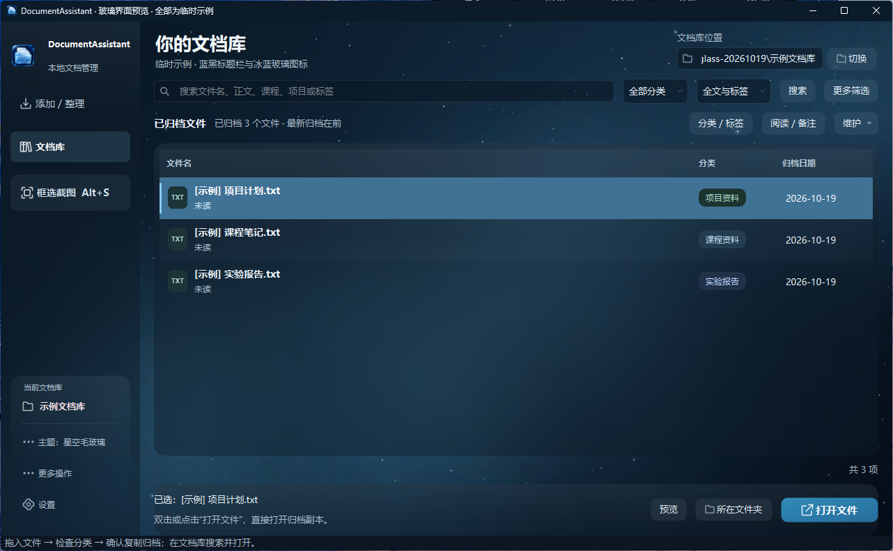
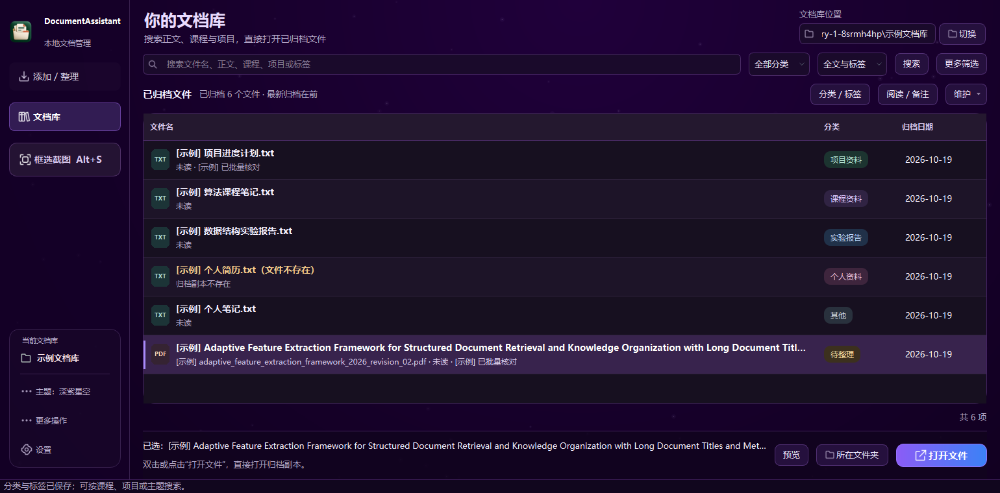
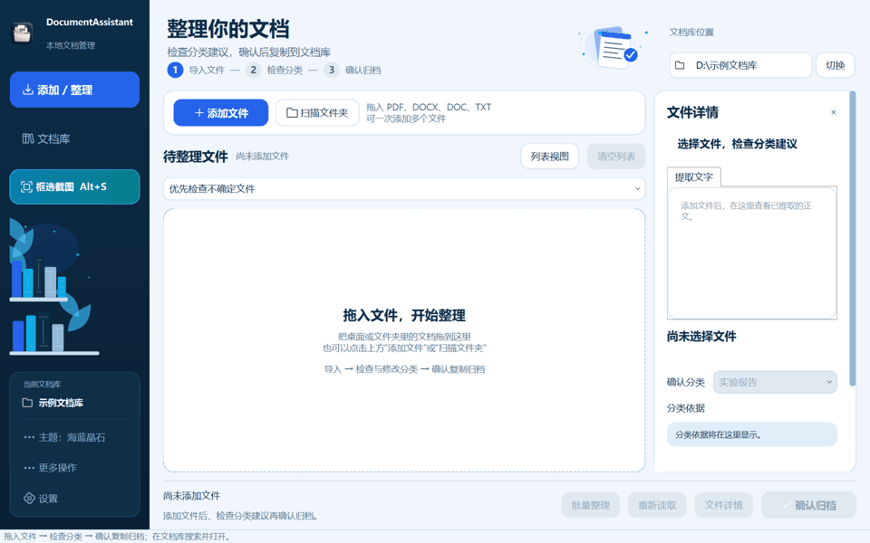
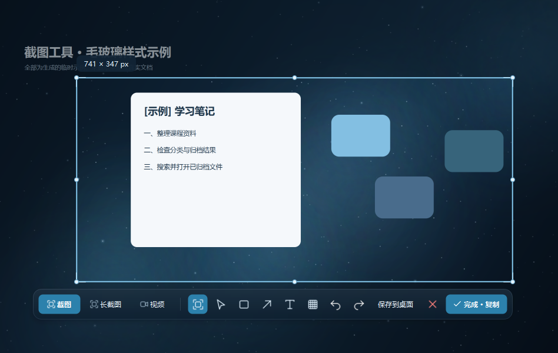
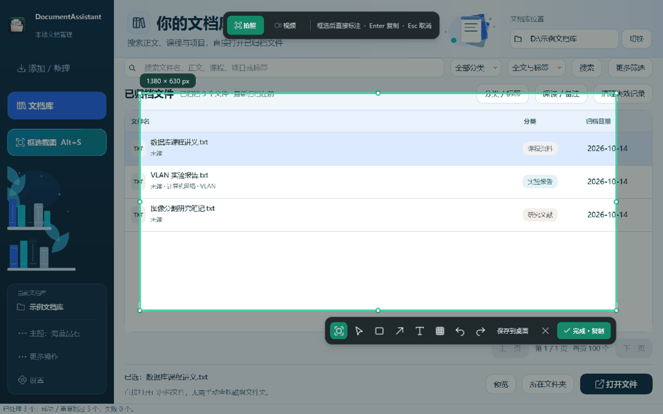
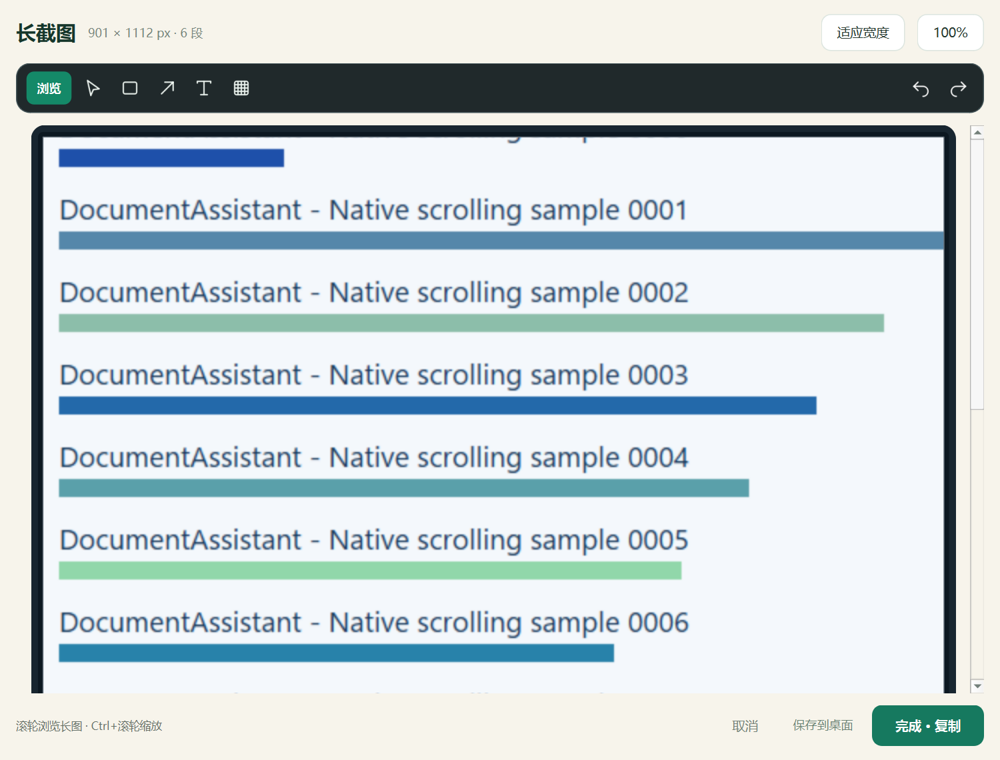
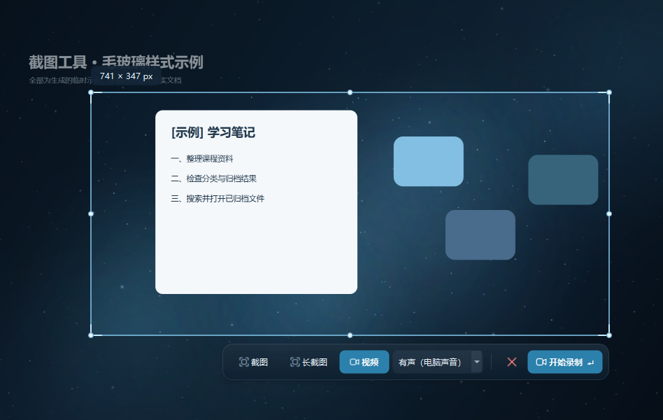
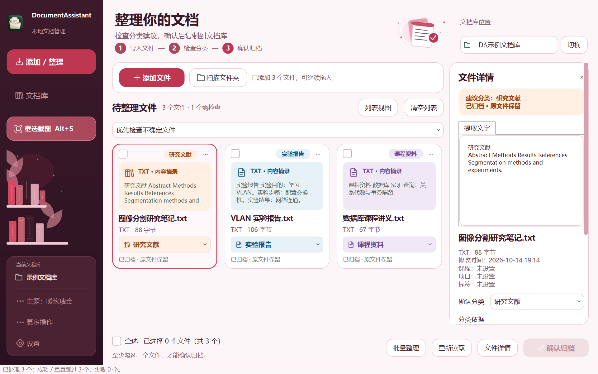

# DocumentAssistant

**把实验报告、课程资料和文献整理好，也把截图留在顺手的位置。**

Windows 本地文档管理与截图工具。按文档内容建议分类，检查后复制归档；
独立截图、原位标注、滚动长截图和可选声音的录屏。分类与检索在本地完成，无需 AI API。

[下载 Windows 安装包](https://github.com/ZLongLab/DocumentAssistant/releases/latest)
· [快速上手](#快速上手) · [源码运行](#源码运行)



本地源码已同步标题栏与应用图标：星空主题使用蓝黑原生标题栏，窗口、托盘、任务栏和快捷方式统一使用冰蓝玻璃文件夹图标。保留系统窗口按钮；[修改与验证说明](WINDOW_GLASS_UPDATE.md)。

本地源码界面根据最新反馈更新为蓝黑星空与毛玻璃工作台：蓝青星云、冰蓝操作按钮、模糊背景面板和更少的描边，保留全部现有管理功能。毛玻璃采用应用内背景空间模糊，文字保持清晰。示例预览运行 `python test_minimal_design.py`，正常使用仍运行 `Start-DocumentAssistant.cmd`。本轮未重新构建下方的 0.23.3 安装包；下载版与本地源码可能不同。最新说明见 [GLASS_UI_UPDATE.md](GLASS_UI_UPDATE.md)。

**当前源码版本为 0.23.4；下载包仍为 0.23.3，尚未重新构建。** 本地源码进一步修复自动收件箱循环与深目录漏扫、恢复区长路径状态及 PDF 预览，新增 F5 刷新文档库；Ctrl+F 快速进入搜索。217 项自动测试及临时示例的 Windows 原生操作流程通过。[本轮检查与验证](REVIEW_FOLLOWUP_20261021.md) · [此前归档与备份修复](REVIEW_FIXES_20261021.md)。已有旧进程需从托盘退出后重开，窗口标题应显示 0.23.4。

## 下载和安装

本地文档库页面已进一步优化文字、搜索高亮、深色标签、单选/多选操作和长标题显示。“清理失效记录”位于文档库的“维护”菜单。已运行的旧窗口需要从托盘“退出”后重开，才能加载更新代码。[本轮说明与验证](LIBRARY_UI_UPDATE.md)



当前下载版 **0.23.3**，适用于 Windows 10 / 11 x64。

前往 [Releases](https://github.com/ZLongLab/DocumentAssistant/releases/latest)，选择：

| 文件 | 使用方式 |
| --- | --- |
| `DocumentAssistant-0.23.3-Windows-x64-Setup.exe` | 双击安装，可选择目录并创建快捷方式；无需另装 Python |
| `DocumentAssistant-0.23.3-Windows-x64-Portable.zip` | 解压整个文件夹，双击 `DocumentAssistant.exe`；请保留 `_internal` 目录 |
| `SHA256SUMS.txt` | 下载文件的 SHA256 校验值 |

有 D 盘时，安装向导默认使用 `D:\Apps\DocumentAssistant`；也可以选择其他位置。
安装后通过桌面或开始菜单快捷方式启动。关闭主窗口后继续驻留托盘，
需要完全关闭时，在托盘菜单选择“退出”。首次启动可在设置中选择开机自启动。

## 快速上手

### 整理文档

1. 选择一个文档库，例如 `D:\DocumentLibrary`。
2. 添加文件或扫描文件夹，查看建议分类及提取的正文。
3. 按需要修改分类、课程、项目或标签，再点击“确认归档”。
4. 进入文档库，搜索文件名、正文或标签，直接打开已归档文件。Ctrl+F 快速进入搜索；F5 刷新当前结果及文件状态。

归档采用复制方式，保留来源文件；重复内容会提示，同名文件自动编号。
自动分类是建议，请检查不确定的文件。



### 截图与标注

本地源码的截图工具栏已同步为蓝黑毛玻璃和冰蓝选区，减少描边与阴影；[更新及验证说明](CAPTURE_GLASS_UPDATE.md)。已有进程需从托盘退出后重开。

“截图 / 长截图 / 视频”现已合并进选区旁的工具栏，默认在选区下方，窄屏时在同一面板内分两行显示；[双向长截图与合并工具栏说明](CAPTURE_UNIFIED_UPDATE.md)。

高 DPI 下框选时的画面错位已修复，改为按原始物理像素比例显示与裁剪；[修复和验证范围](CAPTURE_STABILITY_FIX.md)。



1. 程序运行时按 **Alt+S**，默认进入拍照模式。
2. 拖动选择区域，直接在选区旁的工具栏标注矩形、箭头、文字或马赛克。
3. 按 Enter 或点击“完成 · 复制”复制图片；需要文件时点击“保存到桌面”。

文字输入后，第一次 Enter 确认文字，第二次 Enter 复制图片。
马赛克支持自由涂抹，圆形光标预览笔刷范围；笔刷和颗粒大小可分别调整。
各工具记住自己的颜色和尺寸。Ctrl+Z 撤销，Ctrl+Y 重做，Esc 取消。
快捷键可在设置中修改；已有用户会保留自己的设置。
需要截取下拉菜单时，先展开菜单，再直接按完整截图快捷键；程序会尽量保留按键前的菜单画面。



### 滚动长截图

2026-10-20 本地源码进一步加速长截图：采集目标间隔为 16ms，优先匹配唯一文本行，用 NumPy 批量验证接缝，并按原生像素截取所选区域。保留框选首屏、结束时的最后一帧及双向拼接；[性能对照与验证范围](LONG_CAPTURE_PERFORMANCE_UPDATE.md)。正在运行的程序需从托盘“退出”后重开。

已处理暂停重绘、消息操作按钮显隐和文字行取整；[早期测试记录](LONG_CAPTURE_RESUME_UPDATE.md)、[前三组真实重放](LONG_CAPTURE_REAL_REPLAY_FIX.md)。用户后续两组诊断又暴露了单行消息、大块留白和底部渐隐的断接条件，本轮增加稀疏页面的完整背景与唯一轮廓检查；五组首次断接均通过重放，100%/150% 浏览器渲染的连续上下滚动、暂停、换向序列也通过。[最新修复与验证范围](LONG_CAPTURE_SPARSE_FIX.md)。用户实时完整流程仍待重新操作确认。若再次断接，可点“保存诊断”，将选区短序列、失败画面和已采集长图主动保存在本机；[诊断说明](LONG_CAPTURE_DIAGNOSTICS.md)。

1. 按截图快捷键，在下方工具栏选择“长截图”。
2. 只框选需要的正文区域，避开固定导航和滚动条，按 Enter 开始。
3. 在选区内向上或向下滚动，程序在长图对应的一端补入新内容；经过已采集区域时不重复添加，避免一次跳过整屏。
4. 点击“完成采集”、按 Enter，或再按截图快捷键结束；进入长图预览后可以标注、复制或保存 PNG。

预览默认适应宽度，滚轮浏览，Ctrl+滚轮缩放。默认操作仍为“完成 · 复制”，
保存是旁边的次要入口。采集过程中可按 Esc 取消，或通过托盘结束长截图。

找不到可靠重叠时会保留当前长图并提示返回最近采集的位置，恢复重叠后可以继续；超过长图的上端或下端时会继续扩展。
局部悬浮按钮、小动画和轻微重绘会做容错；采集时可查看段数和像素高度是否增加。
尚未拼接会明确提示，结束时若仍只有一屏，预览会显示原因与重新采集说明。
请使用布局稳定的页面，支持向上或向下滚动。动态视频、重复图案和滚动后始终变化的内容可能无法拼接；一次跳过整屏、完全没有重叠时仍需返回最近采集位置。
长图最多 20,000 像素高且不超过 2,400 万像素，达到上限后保留已采集内容。



### 录屏与主题

截图界面切换“视频”，在旁边选择“无声”或“有声（电脑声音）”，框选区域后按 Enter，倒计时结束开始录制。
有声模式录入 Windows 默认播放设备的课程、视频等声音，不启用麦克风；无声模式只录画面。
再次按截图快捷键或点击停止，预览后保存 MP4。有声预览支持播放声音和静音。[实现与验证说明](VIDEO_AUDIO_UPDATE.md)



侧栏的主题按钮可以切换“星空毛玻璃”“海蓝晶石”和“暖玫瑰金”，下次启动自动恢复。新版工作台首次使用星空毛玻璃，后续尊重用户的主题选择。文件详情默认收起，可从底部“文件详情”展开。

<details>
<summary>查看暖玫瑰金主题</summary>



</details>

演示使用虚构示例资料，不包含个人文档或真实桌面内容。

## 功能范围

- PDF、DOCX、TXT 及部分旧版 DOC 的正文提取与规则分类。
- 文件名、正文、标签和备注检索，阅读状态、PDF 页面预览及打开文件。
- 重复文件提示、归档恢复、文档库备份与恢复。
- 截图、原位标注、自由马赛克、滚动长截图、无声/电脑声音区域录屏、托盘及开机自启动。

扫描件 OCR、AI 问答和云同步尚未提供。Word 原始排版预览尚未提供。
录屏约 20 帧/秒，需要可用的 H.264 编码器；有声模式还需要 AAC 编码器和 Windows WASAPI 回录设备。目前不提供麦克风录制或视频剪辑。
多显示器、不同缩放比例及不同电脑的编码器兼容性仍需进一步验证。

## 数据位置和卸载

默认在程序目录旁创建 `DocumentAssistant-local`，保存设置、缓存和录屏临时文件。
文档库由你单独选择，截图默认保存到当前 Windows 用户的桌面。
`DOCUMENTASSISTANT_HOME` 环境变量或独立程序的 `--home` 参数可指定运行目录。

安装版可从 Windows“已安装的应用”卸载。卸载保留运行数据、文档库和已保存的截图，
并移除属于该安装位置的自启动项。免安装版退出程序后可删除程序文件夹，
如启用过自启动，请先在设置中关闭。

## 源码运行

需要 Python 3.11+。在项目文件夹打开 PowerShell：

```powershell
powershell -NoProfile -ExecutionPolicy Bypass -File .\setup.ps1
```

安装脚本创建 `.venv`、安装依赖并创建快捷方式；首次安装需要网络。
安装后双击 `Start-DocumentAssistant.cmd`，使用本地功能无需联网。
也可指定 Python：

```powershell
powershell -NoProfile -ExecutionPolicy Bypass -File .\setup.ps1 -Python "D:\Python\python.exe" -NoShortcuts
```

项目使用 Python、PySide6 和 SQLite。[Windows 打包方法](packaging/README.md)
及 [第三方组件说明](THIRD_PARTY_NOTICES.md) 随源码提供。

## 开发验证

在已安装依赖的项目目录运行：

```powershell
$env:PYTHONDONTWRITEBYTECODE = '1'
$env:QT_QPA_PLATFORM = 'offscreen'
.\.venv\Scripts\python.exe -m unittest discover -s tests -v

$env:QT_QPA_PLATFORM = 'windows'
.\.venv\Scripts\python.exe validate_minimal_layout.py --layout minimal
.\.venv\Scripts\python.exe validate_minimal_layout.py --layout classic
```

2026-10-19：147 项临时示例/模拟回归测试通过，两种真实 Windows 窗口的初始化、导航、主题切换和关闭检查通过。隔离的 Qt 测试不替代真实系统剪贴板、长时间录屏或其他电脑的兼容性验证；标题栏、截图和声音的实际验证范围见各更新说明。
