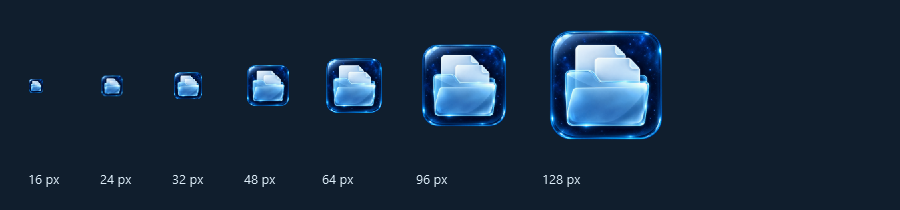

# 标题栏与玻璃图标更新

2026-10-19，本地源码版本 0.23.3。没有重新构建或发布安装包。

## 效果


- 星空主题的系统标题栏改为蓝黑色 `#0b1b2a`，配浅色文字和系统窗口按钮，取消明显外边线。浅色主题会同步恢复相应颜色。
- 保留原生窗口结构，不替换为无框窗口。标题栏采用系统颜色设置，与应用内毛玻璃协调；标题栏本身没有开启 Acrylic、Mica 或桌面实时模糊。
- 新图标为冰蓝玻璃文件夹。窗口、侧栏、托盘、任务栏重启入口和源码快捷方式共用图标路径。
- 同时保留 `document_assistant/documentassistant.ico` 供打包配置使用，并用新文件名 `documentassistant-glass.ico` 避免快捷方式继续命中旧图标缓存。未清空系统图标缓存、未重启资源管理器。

## 使用

正在运行的旧窗口需要先通过托盘菜单选择“退出”，再双击 `D:\MyGithub\DocumentAssistant\Start-DocumentAssistant.cmd`，或使用桌面快捷方式。关闭窗口按钮通常只是隐藏到托盘。

已更新本机桌面及开始菜单的 `DocumentAssistant.lnk`；桌面启动热键为 **Ctrl+Alt+D**，截图热键仍独立配置。两处快捷方式指向当前 D 盘源码启动器，并使用新的玻璃 ICO。

桌面：`%Desktop%\DocumentAssistant.lnk`。

开始菜单：`%APPDATA%\Microsoft\Windows\Start Menu\Programs\DocumentAssistant.lnk`。

其他电脑可运行项目原有 `install-shortcuts.ps1` 创建本机快捷方式；下载的旧安装包不包含本轮更新。

## 图标文件与生成记录

PNG 源图：`D:\MyGithub\DocumentAssistant\document_assistant\app-icon.png`，1254 × 1254，圆角外保留透明通道。

Windows 图标：`D:\MyGithub\DocumentAssistant\document_assistant\documentassistant-glass.ico`，包含 16、20、24、32、40、48、64、96、128、256 像素十档尺寸。`scripts/create_icon.py` 从 PNG 同时生成新旧两个 ICO 文件名。



生成方式：内置 `image_gen.imagegen`，新图生成，无参考图片，`transparent_background=true`。提示词如下：

```text
Create one premium Windows desktop application icon for DocumentAssistant, a local document organizer with a blue-black starfield and frosted glass UI. New original icon, not a screenshot or mockup. A rounded square slab of deep midnight navy optical glass, containing a large simple translucent ice-blue glass file folder with two neat frosted-white document sheets emerging from it. Strong recognizable silhouette, fewer details, generous object size filling the tile, icon readable at 16, 24, 32 and 48 pixels. Refined realistic glass refraction, delicate cyan rim illumination and pale blue specular reflections, restrained depth and soft inner shading; elegant productivity software identity. Front facing, nearly orthographic, balanced and centered. Palette midnight navy, icy blue, frosted white, a hint of cyan; no purple, green, orange or gold. No text, letters, numbers, watermark, brand name, background scenery, extra symbols, desk, device, presentation board, or duplicate icons. Perfect square composition, rounded tile corners; genuinely transparent alpha outside the tile, clean cutout. Deliver the icon artwork alone, high quality.
```

## 验证范围

已在本机 Windows 11（build 26200）、Qt 6.12、150% 系统缩放下实际运行检查：

- 三个主题的原生标题栏设置成功，切换时窗口位置和大小不变。
- 实际窗口截图中标题栏像素为 `#0b1b2a`，白条已消失。
- 最大化、还原、最小化、再次显示通过；系统调整大小与窗口按钮样式仍存在。
- PNG 透明通道和 ICO 十档尺寸通过，图标可正常加载，已检查小尺寸效果。
- 桌面、开始菜单快捷方式的图标路径与应用标识已核对。
- 只使用隔离的三个临时 TXT 示例及独立数据库，没有整理真实资料。

尚未在其他电脑、旧版 Windows 10 或新安装包中验证；鼠标拖动和贴靠保留系统行为，未做实际鼠标操作验收。旧系统不支持某些标题栏颜色属性时会保留系统外观，不改动窗口结构。

报告：`D:\MyGithub\DocumentAssistant-local\verification\window-glass-20261019\window-result.json`。

修改前备份：`D:\MyGithub\DocumentAssistant-local\backups\window-glass-20261019-154612`。
